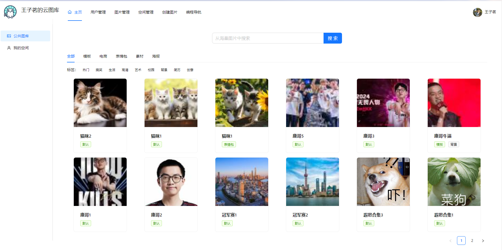
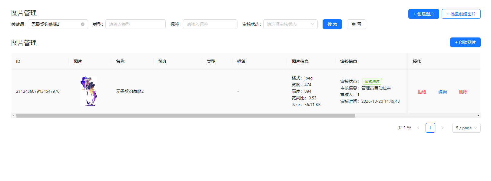
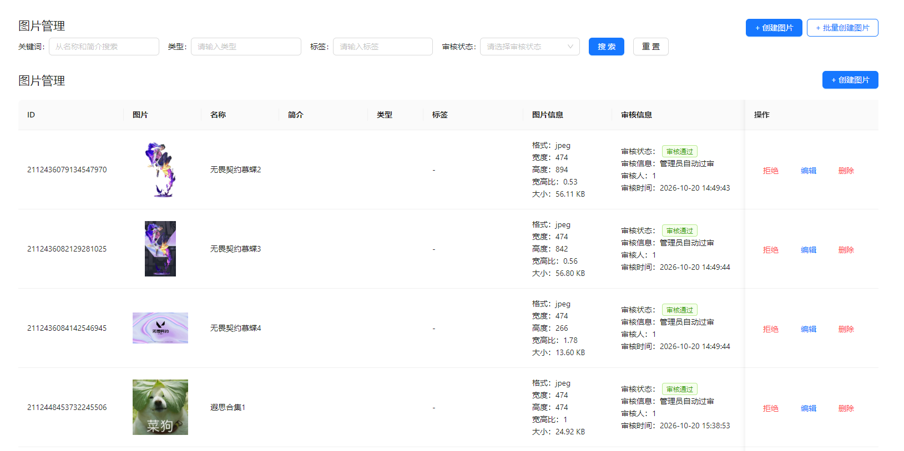
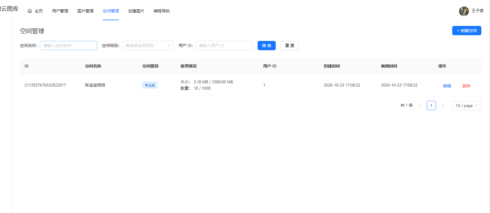
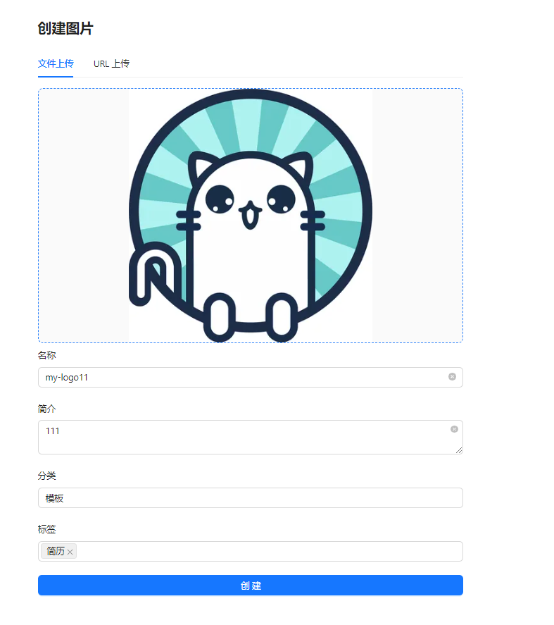
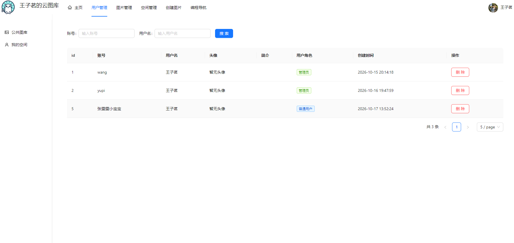
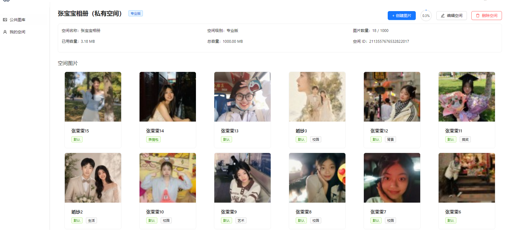
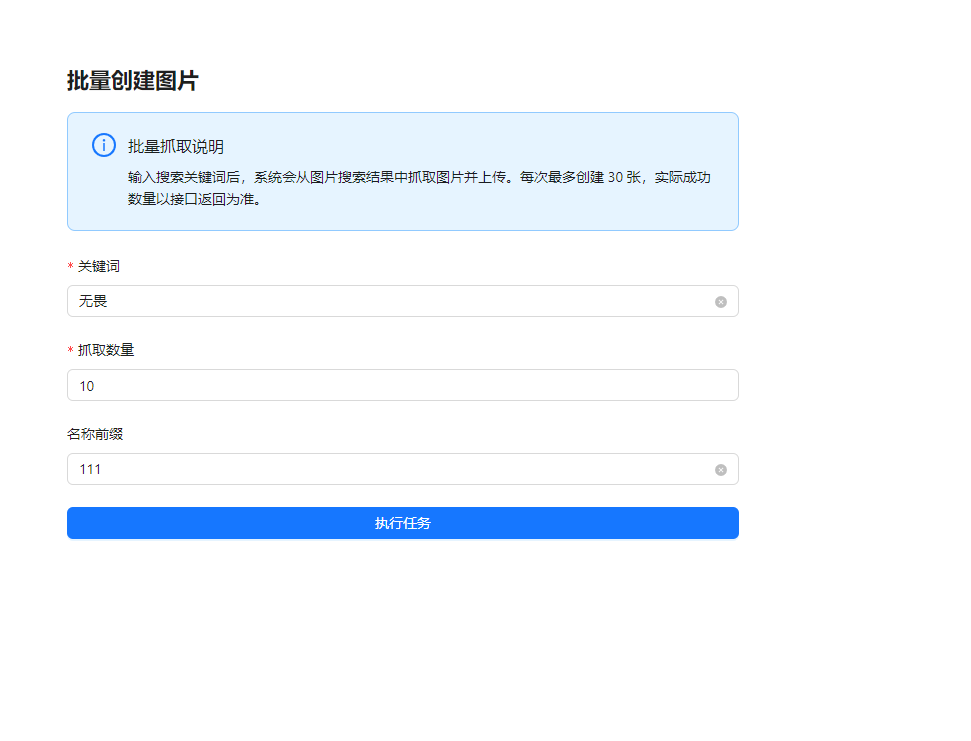

# 智能云图库管理系统 - 后端

基于 Spring Boot 2.7 + Java 11 开发的智能云图库管理系统后端，提供用户管理、图片上传、图片审核、公共图库及私人空间管理等功能。

项目采用前后端分离架构，通过 RESTful API 为 Vue 3 前端提供数据接口，并使用腾讯云 COS 实现图片资源的云端存储与处理。

## 技术栈

- Java 11
- Spring Boot 2.7
- MyBatis-Plus
- MySQL
- Redis
- 腾讯云 COS
- Knife4j
- Maven

## 主要功能

- 用户注册、登录及权限管理
- 公共图库图片浏览、搜索、分类及标签筛选
- 本地图片上传和 URL 图片上传
- 图片压缩、缩略图生成及图片信息管理
- 图片编辑、删除及详情查询
- 图片批量创建
- 管理员用户管理、图片管理与审核
- 私人空间创建、图片管理及空间配额控制

## 系统功能演示

以下截图来自项目实际运行界面，用于展示主要业务功能。

### 1. 系统主页

公共图库首页，展示图片列表与浏览入口。



### 2. 图片管理与关键词检索

通过筛选条件与关键词查找图库中的图片。



### 3. 图片管理

后台图片列表及相关管理操作。



### 4. 空间管理

空间列表与管理页面。



### 5. 本地图片上传

上传本地文件并填写图片名称、简介、分类与标签。



### 6. URL 图片上传

通过图片 URL 上传并编辑图片信息。


### 7. 用户管理

后台用户列表与管理界面。



### 8. 私人空间相册管理

私人空间内的图片展示与管理。



### 9. 批量创建图片

批量创建图片的参数设置与操作界面。



## 本地运行

**1. 克隆项目**

```bash
git clone https://github.com/ZiMing929/picture-backend.git
cd picture-backend
```

**2. 初始化数据库**

使用 `sql` 目录下的数据库脚本初始化 MySQL 数据库。

**3. 配置运行环境**

确保本地已安装并配置：

- JDK 11
- MySQL
- Redis
- Maven
- 腾讯云 COS 存储桶及访问凭证

根据项目配置文件设置数据库、Redis 和 COS 参数。敏感信息建议使用环境变量或本地配置文件管理，不要提交到 GitHub。

**4. 启动项目**

使用 IntelliJ IDEA 启动 Spring Boot 主程序，或在 Windows 终端执行：

```bash
.\mvnw.cmd spring-boot:run
```

**5. 访问后端服务**

默认本地接口地址：

```text
http://localhost:8124/api
```

实际地址以项目配置为准。

## 前端项目

本项目为智能云图库管理系统的后端部分。

前端采用 Vue 3、TypeScript、Vite 和 Ant Design Vue 开发，实现公共图库展示、图片上传、图片管理及私人空间等交互功能。

前端 GitHub 仓库：

https://github.com/ZiMing929/picture-frontend

## 项目说明

本项目用于个人学习与全栈开发实践，涵盖 Spring Boot 后端开发、数据库设计、权限管理、前后端接口交互及腾讯云对象存储集成。
